<p align="center">
  
</p>

<h1 align="center">Hola, soy Jairo Alejandro Ojeda Herrera 👋</h1>

<p align="center">
  <strong>Estudiante de Ingeniería en Ciencias de la Computación</strong><br />
  Construyo productos que unen ingeniería, diseño y experiencias interactivas.<br />
  📍 Quito, Ecuador · UTC−5
</p>

<div align="center">

<a href="https://github.com/Alejandro120325?tab=repositories"></a>
<a href="https://www.linkedin.com/in/jairo-alejandro-ojeda-herrera-9466543a6/"></a>
<a href="mailto:alejandro.ojedaherrera@gmail.com"></a>

</div>

## 👋 Sobre mí

Soy **Jairo Alejandro Ojeda Herrera**, estudiante de **Ingeniería en Ciencias de la Computación** en la Universidad Politécnica Salesiana. Desarrollo soluciones full-stack con una idea clara: la tecnología debe ser sólida por dentro, intuitiva por fuera y útil para quien la utiliza.

```typescript
const alejandro = {
  ubicacion: "Quito, Ecuador 🇪🇨",
  construye: ["aplicaciones full-stack", "experiencias web interactivas", "sistemas distribuidos"],
  cuida: ["arquitectura", "rendimiento", "seguridad", "UI/UX"],
  explora: ["cloud", "inteligencia artificial", "visualización 3D"],
  principio: "Código limpio. Diseño intencional. Mejora continua."
};
```

<table>
  <tr>
    <td width="33%" align="center">
      <strong>⚙️ Ingeniería</strong><br />
      Arquitecturas mantenibles, APIs y datos.
    </td>
    <td width="33%" align="center">
      <strong>✨ Experiencia</strong><br />
      Interfaces responsivas con identidad visual.
    </td>
    <td width="33%" align="center">
      <strong>🚀 Evolución</strong><br />
      Aprendizaje continuo y mejora medible.
    </td>
  </tr>
</table>

## 🚀 Proyectos seleccionados

### 📚 FOLIO — Librería digital full-stack

Catálogo y carrito, autenticación JWT, roles, dashboards, búsqueda inteligente y una experiencia visual 3D construida con Three.js y GSAP.

`JavaScript` · `Node.js` · `Express` · `PostgreSQL` · `Three.js` · `GSAP`

**[Ver demo ↗](https://alejandro120325.github.io/FOLIO/)** · **[Explorar código →](https://github.com/Alejandro120325/FOLIO)**

---

### 📍 GeoKipu — Ubicación compartida con consentimiento

Aplicación web y móvil para grupos de confianza, con privacidad por diseño, GPS, mapas, bitácora, alertas y gestión de integrantes.

`React` · `Vite` · `Express` · `MongoDB` · `Expo / React Native`

**[Explorar código →](https://github.com/Alejandro120325/app-ubicacion-quito)**

---

### 🪐 EduCosmos 4 — Aprendizaje inmersivo del Sistema Solar

Plataforma educativa alineada con el ODS 4: exploración 3D, perfiles, minijuegos, ranking, bitácora y administración de usuarios.

`Java` · `JSP / Servlets` · `PostgreSQL` · `Three.js` · `Maven / Tomcat`

**[Explorar código →](https://github.com/Alejandro120325/Sistema-Solar)**

---

### 🏛️ Museo Alberto Mena Caamaño — Experiencia cultural interactiva

Recorrido web responsivo con narrativa visual, galería multimedia, evaluación interactiva, temas claro/oscuro y animaciones cinematográficas.

`HTML` · `CSS` · `JavaScript` · `GSAP` · `AOS`

**[Ver demo ↗](https://alejandro120325.github.io/MUSEO/)** · **[Explorar código →](https://github.com/Alejandro120325/MUSEO)**

<div align="center">

<strong><a href="https://github.com/Alejandro120325?tab=repositories">Ver todos mis proyectos →</a></strong>

</div>

## 🧰 Stack tecnológico

<div align="center">

<p><strong>Lenguajes y frontend</strong></p>


<p><strong>Backend, datos y experiencias</strong></p>


<p><strong>Herramientas</strong></p>


</div>

## 🧭 En qué estoy trabajando

- 🧵 **Sistemas distribuidos:** [comunicación cliente-servidor y concurrencia](https://github.com/Alejandro120325/Taller-Grupal-Sockets-Multihilo) con sockets multihilo en Python.
- 🧠 **Inteligencia artificial:** [fundamentos de Python y NumPy](https://github.com/Alejandro120325/Practica_01_IA) en notebooks reproducibles.
- ☁️ **Arquitectura cloud:** despliegue y separación de frontend, API y persistencia para aplicaciones full-stack.
- 🎨 **Experiencias interactivas:** visualización 3D, motion design y accesibilidad aplicada a productos web.

## 📊 Actividad en GitHub

<div align="center">


<sub>Las métricas se generan automáticamente a partir de la actividad pública en GitHub.</sub>

</div>

## 🤝 Conectemos

Si quieres conversar sobre desarrollo web, sistemas, diseño de producto o construir algo interesante, escríbeme:

<div align="center">

<p><strong><a href="mailto:alejandro.ojedaherrera@gmail.com">Correo</a> · <a href="https://www.linkedin.com/in/jairo-alejandro-ojeda-herrera-9466543a6/">LinkedIn</a> · <a href="https://github.com/Alejandro120325">GitHub</a> · <a href="https://www.instagram.com/alejo_ojeda1203/">Instagram</a></strong></p>

<h3><code>Código limpio · Diseño intencional · Mejora continua</code></h3>

<sub>Diseñado y mantenido con disciplina desde Quito, Ecuador.</sub>

</div>

